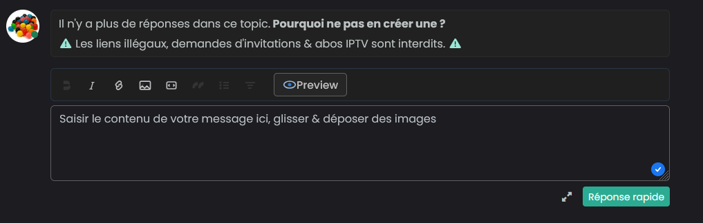

📋 Markdown menu avec Preview, pensé pour Planet-Warez notamment

Ajoute une barre d’outils Markdown moderne et élégante avec prévisualisation en direct sous chaque zone de texte sur le site.

Fonctionnalités

* Barre d’outils Markdown : gras, italique, lien, image, code, citation, listes, centrage
* Aperçu live
* Installation en 1 clic : compatible Tampermonkey, Violentmonkey, Greasemonkey
* S’intègre sur tous les textarea

Installation rapide

[Cliquer sur le script](https://github.com/Aerya/Planet-Warez-Markdown-menu/raw/refs/heads/main/markdown-toolbar.user.js) pour l'installer sous Grease/Tamper/ViolentMonkey
Recharger la page

Aperçu

⚙️ Configuration

Pour changer le site cible, modifier la ligne ou en ajouter

    // @match        https://planete-warez.net/*
    // @match        https://autre-forum.net/*
    // @match        https://*.wikipedia.org/*
